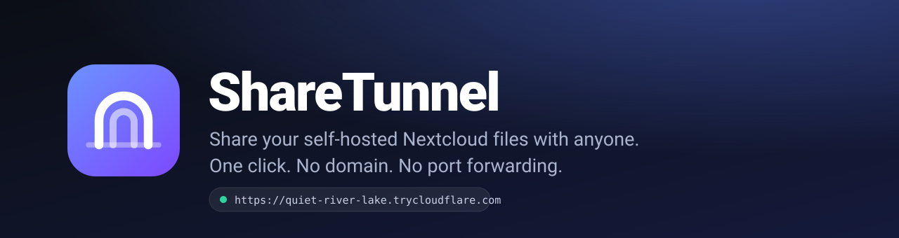
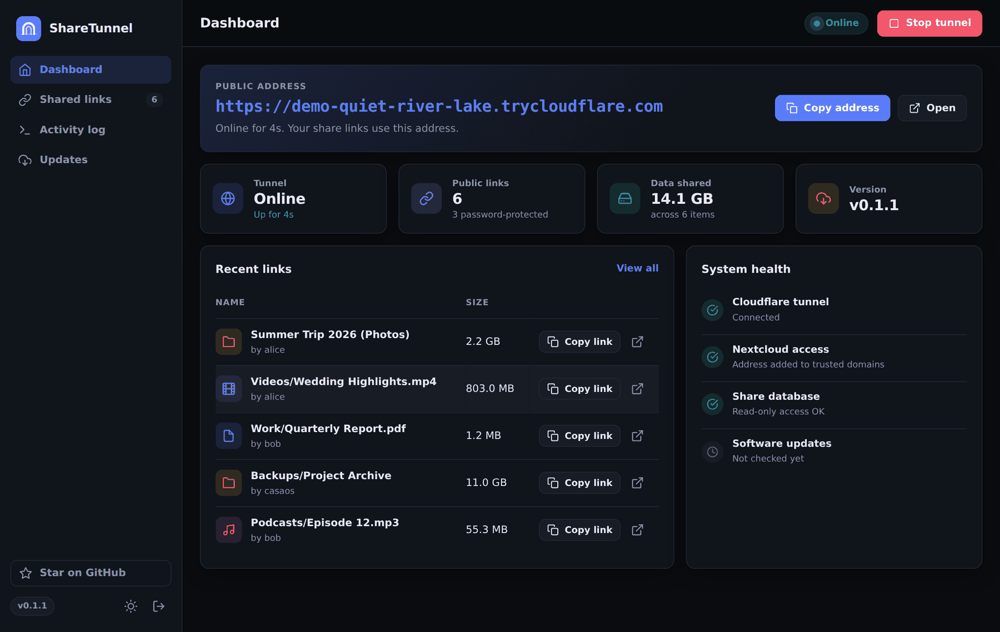
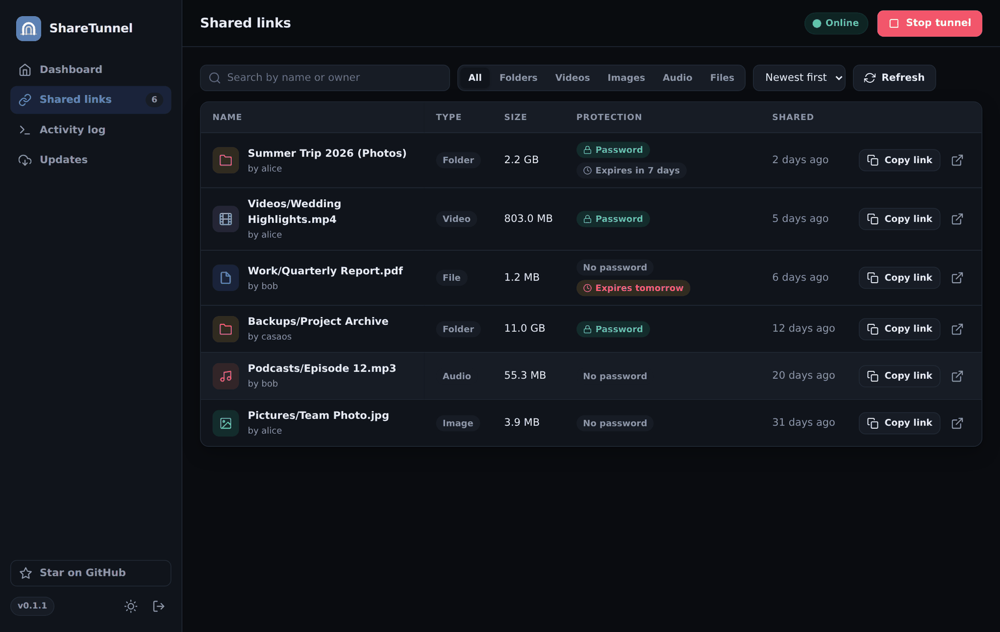
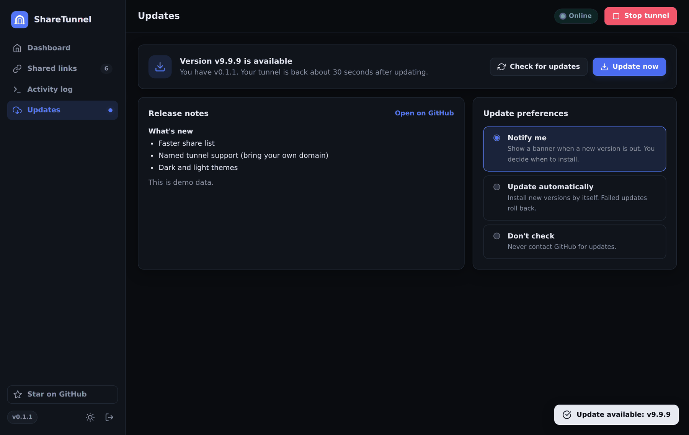
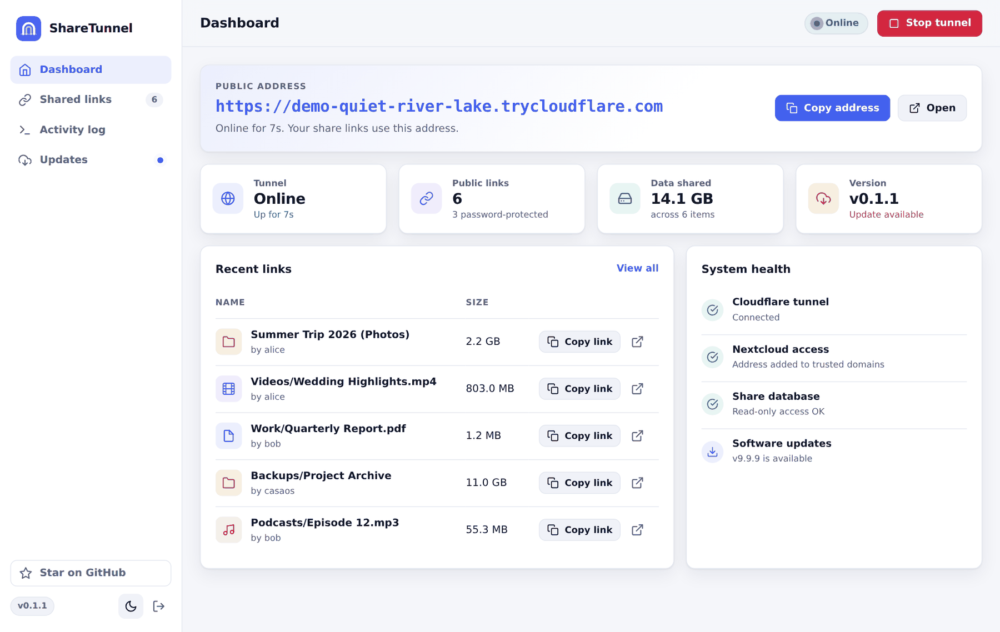
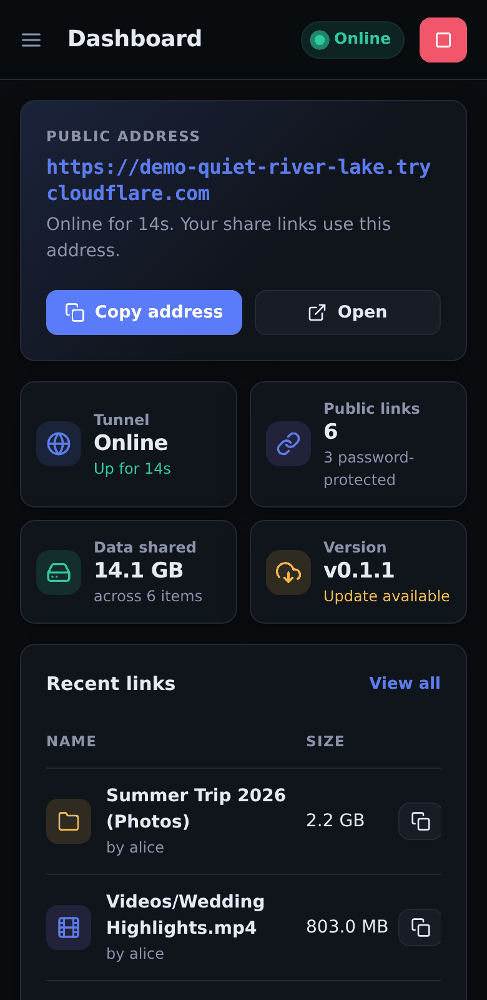
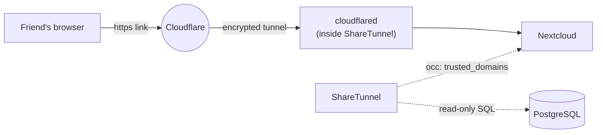

<p align="center">
  
</p>

<p align="center">
  <b>Share files from your self-hosted Nextcloud with anyone, anywhere, in one click.</b><br>
  No domain. No port forwarding. No config files.
</p>

<p align="center">
  <a href="https://github.com/Shariqtechie/Sharetunnel/releases"></a>
  <a href="https://github.com/Shariqtechie/Sharetunnel/actions/workflows/ci.yml"></a>
  <a href="LICENSE"></a>
  
  <a href="https://github.com/Shariqtechie/Sharetunnel/stargazers"></a>
</p>

<p align="center">
  <a href="#-try-the-demo">Demo</a> ·
  <a href="#-quick-start">Quick start</a> ·
  <a href="#-how-it-works">How it works</a> ·
  <a href="#%EF%B8%8F-configuration">Configuration</a> ·
  <a href="#-faq">FAQ</a> ·
  <a href="#-roadmap">Roadmap</a>
</p>

<p align="center">
  
</p>

## The problem

Nextcloud share links only work on your home network. To send a file to a friend you either open ports on your router (risky), or buy a domain, set up a Cloudflare named tunnel, and edit `config.php` by hand every time something changes.

**ShareTunnel does all of that for you.** It opens a secure Cloudflare tunnel to Nextcloud, tells Nextcloud to trust the new address, and shows every public link in a clean dashboard where you copy it with one click.

## ✨ Features

- **One-click public access.** Start the tunnel and you have an HTTPS address anyone can open. No account, domain or router changes.
- **Automatic Nextcloud setup.** The temporary address is added to `trusted_domains` and removed again when you stop. Never edit `config.php` yourself.
- **See everything you share.** Every public link from every user, with type (folder, video, image, audio, file), size, owner, password and expiry. Search, filter and sort.
- **Always the right link.** The address changes when the tunnel restarts. Copy links always use the current one.
- **Self-updating.** Checks GitHub Releases, shows the release notes, updates in one click (or automatically at a time you choose) and **rolls back by itself** if the new version fails to start.
- **Self-healing.** Restarts the tunnel if it drops and resumes after a reboot or power cut.
- **A dashboard you will enjoy.** Light and dark themes, health checks, activity log, works on your phone.
- **Tiny and private.** One Go binary, about 15 MB of RAM, no database, no telemetry, no third-party requests.
- **Runs on anything.** amd64 and arm64, so a Raspberry Pi works as well as a mini PC.

<p align="center">
  
  
</p>
<p align="center">
  
  
</p>

## 🎮 Try the demo

See the whole panel in 10 seconds, with fake data. No Nextcloud needed:

```bash
docker run --rm -p 9099:9099 -e DEMO=true ghcr.io/shariqtechie/sharetunnel:latest
```

Open <http://localhost:9099> and sign in with password `demo`.

## 🚀 Quick start

**You need:** a Linux host running Docker, with Nextcloud in Docker and a **PostgreSQL** database (for example Nextcloud installed from the CasaOS app store).

1. Save this as `docker-compose.yml` and **set a real password**:

   ```yaml
   services:
     sharetunnel:
       image: ghcr.io/shariqtechie/sharetunnel:latest
       container_name: sharetunnel
       network_mode: host
       restart: unless-stopped
       environment:
         PANEL_PASSWORD: "change-me"      # required
         TZ: Europe/London                # your time zone
         NC_CONTAINER: nextcloud          # name of your Nextcloud container
         NC_URL: http://localhost:7580    # where Nextcloud listens on this host
         DB_CONTAINER: db-nextcloud       # name of your PostgreSQL container
       volumes:
         - /var/run/docker.sock:/var/run/docker.sock
         - ./data:/data
   ```

2. Start it:

   ```bash
   docker compose up -d
   ```

3. Open `http://<your-server-ip>:9099`, sign in, and press **Start tunnel**.

Not sure about your container names or port? Open the **Setup** page in the panel: it checks everything, lists the Nextcloud and PostgreSQL containers it finds, and lets you pick them with one click. You can also run `docker exec sharetunnel sharetunnel doctor` (or `docker ps`) from a terminal.

Then in Nextcloud create a share link as usual. It appears in ShareTunnel with a **Copy link** button that already uses the public address.

### Something not working on first start?

ShareTunnel checks its own setup and tells you what to fix in plain words, instead of failing silently.

| You see | What it means | Fix |
|---|---|---|
| "Can't reach Docker" | The Docker socket isn't mounted | Add `-v /var/run/docker.sock:/var/run/docker.sock` |
| "No container named ... was found" | Your Nextcloud has a different container name | Pick it on the **Setup** page |
| "Nothing is answering at http://localhost:..." | Wrong Nextcloud port | Enter the right address on the **Setup** page (`docker port <nextcloud>` shows it) |
| "Share database" warning | Wrong database container, or MySQL/MariaDB (not supported yet) | The tunnel still works; fix the name on the **Setup** page |
| "port 9099 is already in use" | Another program uses the panel port | Set `PANEL_PORT` to a free port, for example `-e PANEL_PORT=9100` |

If Nextcloud isn't ready yet (for example right after a reboot), ShareTunnel waits and starts the tunnel by itself as soon as it is.

## 🔍 How it works



1. ShareTunnel runs a Cloudflare **quick tunnel** pointing at Nextcloud and reads the new `*.trycloudflare.com` address.
2. It runs `occ config:system:set trusted_domains` in your Nextcloud container, so Nextcloud accepts the address.
3. It lists public shares with a **read-only** database query and builds each link from the live address.
4. When you stop, or the container shuts down, the address is removed from `trusted_domains` again.

## ⚙️ Configuration

All settings are environment variables.

| Variable | Default | Description |
|---|---|---|
| `PANEL_PASSWORD` | *(required)* | Password for the panel. The app refuses to start without one. |
| `PANEL_PORT` | `9099` | Port of the web panel. |
| `NC_CONTAINER` | `nextcloud` | Name of the Nextcloud container. |
| `NC_URL` | `http://localhost:7580` | Address of Nextcloud as seen from the host. |
| `DB_CONTAINER` | `db-nextcloud` | Name of the PostgreSQL container. |
| `TRUSTED_INDEX` | `50` | The `trusted_domains` slot ShareTunnel owns. |
| `SELF_CONTAINER` | `sharetunnel` | This container's own name (needed for updates). |
| `TZ` | `UTC` | Time zone, used for the automatic update hour. |
| `DATA_DIR` | `/data` | Where settings are stored. Mount a volume here. |
| `GITHUB_REPO` | `Shariqtechie/Sharetunnel` | Where update checks look for releases. |
| `DEMO` | `false` | Fake data, no Docker or tunnel needed. |

## 🔄 Updating

ShareTunnel updates itself. In the panel open **Updates**:

- **Notify me** shows a banner when a release is out (default).
- **Update automatically** installs new versions at the hour you choose.
- **Don't check** never contacts GitHub.

An update pulls the new image, swaps the container, waits until it answers health checks and removes the old one. If the new version does not become healthy within 75 seconds, the previous one is restored automatically. You can also update manually with `docker compose pull && docker compose up -d`.

## 🔒 Security

- The tunnel exposes **only Nextcloud**. The panel stays on your LAN or VPN and is never tunnelled. Do not port-forward it.
- Shares are read with a **read-only** database session. ShareTunnel never writes to Nextcloud's database.
- The panel has password login, brute-force lockout, `SameSite=Strict` `HttpOnly` cookies and a strict Content-Security-Policy.
- **Be aware of the Docker socket.** ShareTunnel needs `/var/run/docker.sock` to run `occ` and to update itself. Anything with that access can control Docker on the host, so choose a strong password and keep the panel private.
- Use passwords and expiry dates on sensitive Nextcloud shares, and enable 2FA for your Nextcloud accounts.

Details and how to report a vulnerability: [SECURITY.md](SECURITY.md).

## ❓ FAQ

**Do my old links stop working when the address changes?**
Yes, the part before `/s/...` changes whenever the tunnel restarts, because quick tunnels get a new random name each time. Share tokens stay the same, and the panel always gives you the current link. If you need a permanent address, see the roadmap (named tunnels).

**Are quick tunnels okay to use?**
Cloudflare provides them for testing and gives no uptime guarantee, and their terms of service apply. They are great for sending files to friends and family. For a business or a permanent public address, wait for named tunnel support or run your own.

**Which Nextcloud setups work?**
Developed and tested with the Big Bear Nextcloud app on CasaOS (Nextcloud and PostgreSQL in Docker). Other Docker setups with PostgreSQL should work if you set the container names. MySQL and MariaDB are not supported yet.

**Does it work on Docker Desktop (Windows or macOS)?**
Not currently. ShareTunnel needs Docker's host networking, which Docker Desktop does not provide. Use a Linux host.

**Can I share Jellyfin, Immich or other apps?**
Not yet. It is built for Nextcloud.

**Why does it need the Docker socket?**
To run `occ` inside your Nextcloud container and to replace itself during updates. A restricted socket-proxy option is on the roadmap.

## 🗺️ Roadmap

- [ ] Named tunnels for a permanent address on your own domain
- [ ] MySQL and MariaDB support
- [ ] CasaOS, Umbrel and Unraid app store listings
- [ ] QR code for each link
- [ ] Notifications (ntfy, Telegram, email) when the address changes
- [ ] Restricted Docker socket proxy mode
- [ ] Create and revoke shares from the panel

Have an idea? [Open a feature request](https://github.com/Shariqtechie/Sharetunnel/issues/new/choose).

## 🤝 Contributing

Contributions are welcome. You can run the whole panel locally in 30 seconds with `DEMO=true go run .`. See [CONTRIBUTING.md](CONTRIBUTING.md).

If ShareTunnel saves you time, a ⭐ helps other people find it.

## 📄 License

[MIT](LICENSE). Built with [Go](https://go.dev), [cloudflared](https://github.com/cloudflare/cloudflared) and [Nextcloud](https://nextcloud.com). Not affiliated with Cloudflare or Nextcloud.
